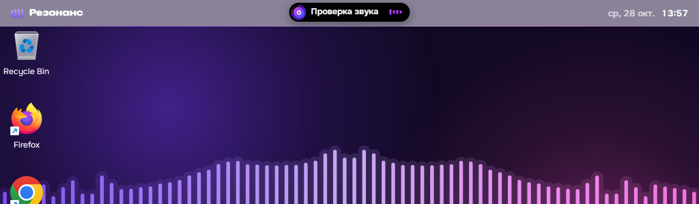
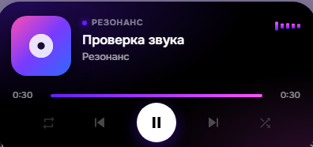
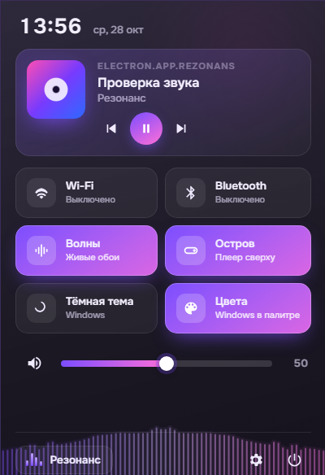
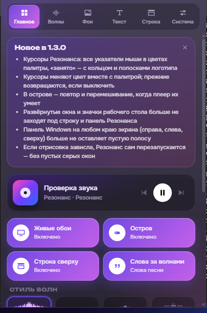
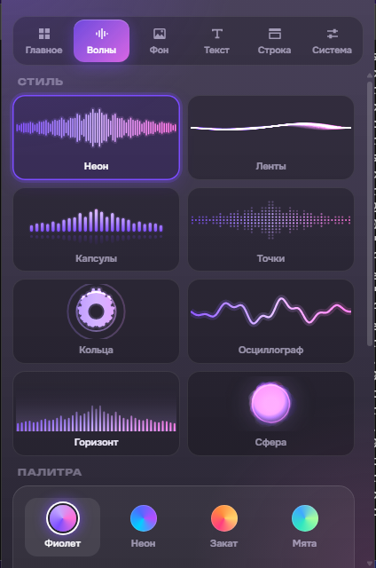
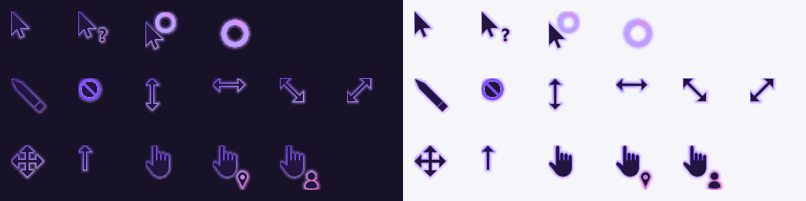

# Резонанс

Один плеер для своих MP3 и Яндекс Музыки на Android, с переносом плейлистов из других сервисов.

- свои MP3 с обложками и тегами, хранятся внутри приложения
- Яндекс Музыка: вход через Яндекс ID прямо в приложении, поиск, плейлисты, «Мне нравится», лента
- перенос плейлистов по папкам: Звук (по ссылке или все сразу после входа), Яндекс Музыка, VK, Spotify, списком или файлом CSV/TXT
- перенесённые треки играют из твоих MP3, а чего нет — из Яндекс Музыки
- перенос лайков: «Мне нравится» из Звука, Spotify и других — в «Мне нравится» Яндекс Музыки
- лента: новинки твоих артистов, похожие артисты, микс
- волны под музыку (6 стилей, 4 палитры), плавная полоска прогресса в такт
- темы: тёмная, чёрная AMOLED, светлая и Liquid Glass (фиолетовая, чёрная, светлая)
- заставка при запуске: светящаяся струна звенит и складывается в логотип (выключается в профиле)
- полноэкранный режим со своей строкой состояния (время, сеть, заряд)
- свайп по обложке или мини-плееру: влево — следующий трек, вправо — предыдущий
- лента: микс из «Моей волны» Яндекс Музыки и персональные плейлисты (Плейлист дня, Дежавю…)
- управление с экрана блокировки и наушников, ♥ в уведомлении

## Установка

1. Открой раздел **Releases** справа на странице репозитория и выбери последнюю версию.
2. Скачай файл `Rezonans-1.1.N.apk` и открой его на телефоне.
3. Разреши установку из этого источника, если телефон спросит.

Новая версия ставится поверх старой, MP3 и плейлисты сохраняются.

## Резонанс для ПК

Windows 11 в цветах Резонанса: живые обои, которые слышат музыку компьютера, остров-плеер
сверху, своя панель задач, «Пуск», быстрые настройки, Alt+Tab и курсоры.

<table>
  <tr>
    <td width="50%" valign="top"> 
      <b>Остров</b> — плеер посередине строки. Наведи мышь — раскроется: обложка, перемотка,
      повтор и перемешивание. Работает с любым плеером из медиа-кнопок Windows.</td>
    <td width="50%" valign="top"> 
      <b>Быстрые настройки</b> (Win+A или часы на панели): что играет, Wi-Fi, Bluetooth,
      обои, остров, тёмная тема, цвета Windows, громкость.</td>
  </tr>
  <tr>
    <td valign="top"> 
      <b>Панель Резонанса</b> — все настройки вживую: логотип на строке или значок в трее.</td>
    <td valign="top"> 
      <b>Волны</b>: восемь стилей и одиннадцать палитр, включая цвета обложки песни.</td>
  </tr>
</table>

**Панель задач** вместо панели Windows: «Пуск» Резонанса, закреплённые и открытые
приложения (правая кнопка — окна, закрепить, закрыть, «Завершить задачу»; значки можно
перетаскивать), трей под стрелкой, сеть и звук, часы. По желанию — прозрачная над обоями.

**Курсоры** — указатели Windows, перекрашенные в палитру, с неоновым свечением.

А ещё: слова песни за волнами (LRCLIB), свой Alt+Tab, капсула громкости на клавишах звука,
системный шрифт Onest и цвета Windows в палитре. Всё возвращается как было одной кнопкой.

**Установка:** в **Releases** выбери последнюю версию «Резонанс для ПК», скачай
`Rezonans-PC-N-setup.exe` и запусти. Если Windows покажет «Система Windows защитила ваш
компьютер» — «Подробнее» → «Выполнить в любом случае».

## Важно

Доступ к Яндекс Музыке и Звуку неофициальный (тот же, что у их сайтов и приложений). Если
сервис что-то поменяет, часть функций может перестать работать до обновления приложения.
Звук блокирует сторонние приложения, поэтому из него только переносятся плейлисты.

Если музыка обрывается при выключенном экране: Настройки телефона → Приложения → Резонанс →
Батарея → «Без ограничений».

## Сборка

APK собирается автоматически на GitHub при каждом изменении в ветке `main`
(`.github/workflows/build-apk.yml`). Локально: `npm ci && npm test && npm run sync`,
затем `./gradlew assembleRelease` в папке `android`. При `npm ci` скрипт
`tools/patch-plugins.mjs` добавляет кнопку ♥ в уведомление плеера.

Резонанс для ПК собирается на GitHub при изменениях в `desktop/`
(`.github/workflows/build-desktop.yml`), выпуск — из ветки `main`, пробные сборки — из `pc-dev`.
Снимки экрана выше — со сборочной машины (ветка `ci-smoke`).
